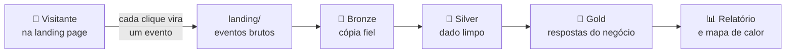
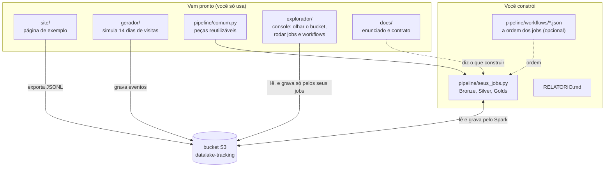

# DadosPro — projeto final de engenharia de dados

Uma empresa vende um curso online por uma landing page de conversão. Uma **landing page** é uma página única, feita para convencer o visitante a fazer uma ação: aqui, comprar o curso DadosPro ou baixar um e-book.

Cada interação do visitante (abrir a página, rolar, dar play no vídeo, comprar) vira um **evento de tracking**: um pequeno registro em JSON que diz o que aconteceu, quando e com quem. Esses eventos são gravados num **bucket S3**, que é uma "pasta na nuvem" para guardar arquivos.

O projeto é construir o **datalake em arquitetura medalhão** que transforma esses eventos em respostas de negócio: funil de compra, engajamento, receita líquida e previsão de compra.

- **Datalake** é um lugar central onde os dados ficam guardados como arquivos, prontos para análise.
- **Arquitetura medalhão** organiza esse datalake em camadas, do dado mais cru ao mais refinado: Bronze (cópia fiel do que chegou), Silver (dado limpo e organizado) e Gold (tabelas que respondem perguntas do negócio).

> **Pense assim:** o projeto é uma **fábrica de dados**. Os eventos são a matéria-prima que chega pelo portão (a landing). Cada camada é uma linha de produção que entrega algo mais acabado para a seguinte, até o produto final (as tabelas Gold), que é o que o gerente da empresa consegue usar para decidir.

O desenho mostra o caminho de um evento: nasce no clique do visitante, entra pela landing e é refinado camada a camada até virar resposta.

Os termos novos estão explicados no [glossário do enunciado](docs/ENUNCIADO.md#glossário).

## O que há aqui

A tabela abaixo mostra as pastas principais do repositório.

| Pasta | O que é |
| --- | --- |
| [`site/`](site/index.html) | a landing page de exemplo. Abra no navegador, navegue e veja cada evento nascer no painel lateral. O botão **Mapa de calor** do painel mostra, por cima da página, a sua Gold de cliques e de rolagem (requisito R11) |
| [`gerador/`](gerador/README.md) | o coletor simulado: popula o bucket com 14 dias de eventos, inclusive com defeitos |
| [`pipeline/`](pipeline/README.md) | onde o datalake é construído |
| [`explorador/`](explorador/README.md) | um console de estudo no estilo do S3, do Glue e do Athena (http://localhost:8501): ver os arquivos de todos os buckets, o catálogo de tabelas, rodar os seus jobs, juntá-los em **workflows** e fazer consultas SQL. Tem tutorial em cada tela e opções de acessibilidade |
| `docs/` | [enunciado](docs/ENUNCIADO.md) e [contrato do evento](docs/CONTRATO_EVENTO.md) |

Em outras palavras: `site/` e `gerador/` produzem os dados; você escreve o código em `pipeline/`; `docs/` diz o que construir.

O diagrama separa o que já existe do que é seu: as setas mostram quem grava e quem lê o bucket.

## Começar

1. Prepare o ambiente: [SETUP.md](SETUP.md). Ele explica o Docker passo a passo, mesmo que você nunca tenha usado.
2. Popule a landing: `docker compose run --rm app python gerador/gerar_eventos.py`. Esse comando cria os eventos simulados e grava no S3 local.
3. Leia o [enunciado](docs/ENUNCIADO.md) e construa o pipeline em `pipeline/` (veja [pipeline/README.md](pipeline/README.md)). O enunciado tem uma seção "Por onde começar" com a ordem sugerida de trabalho.

## Repositório
[https://github.com/Matheus-S-Cruz/big_data_final](https://github.com/Matheus-S-Cruz/big_data_final)

## Evidências da entrega (onde achar cada prova pedida no AVA)

As provas ficam em três pastas, uma por camada do medalhão:
[`bronze_provas/`](bronze_provas), [`silver_provas/`](silver_provas) e
[`gold_provas/`](gold_provas). A Gold reúne as evidências dos cinco jobs Gold
(funil, engajamento, receita, ML e mapa de calor).

O AVA pede seis itens. A tabela abaixo diz onde encontrar cada um.

| Item pedido no AVA | Onde está |
| --- | --- |
| **Print da tela de bucket** | `gold_provas/buckets.png` (tela S3 · Buckets do explorador; mostra o bucket `datalake-tracking` com as camadas) |
| **Print do Data Catalog com o schema** (ex.: `bronze.eventos`) | `gold_provas/banco_de_dados.png` (tela Glue · Data Catalog; mostra os bancos `landing`, `bronze`, `silver`, `gold` e suas tabelas) |
| **Print da execução com sucesso do ETL Job** | Bronze: `bronze_provas/execucao_bronze.png` · Silver: `silver_provas/execucao_silver.png` · Gold: `gold_provas/jobs.png`, `gold_provas/jobs_final.png` e `gold_provas/execucao_mapa_calor.png` |
| **Arquivo do ETL Job** (ex.: `bronze.py`) | `pipeline/bronze.py`, `pipeline/silver.py`, `pipeline/gold_funil.py`, `pipeline/gold_engajamento.py`, `pipeline/gold_receita.py`, `pipeline/gold_ml.py`, `pipeline/gold_mapa_calor.py`, `pipeline/exportar_mapa_calor.py` e o script de sequência `pipeline/rodar_tudo.py` |
| **Print da consulta do Athena** (query executada) | Bronze: `bronze_provas/consultas_bronze_1.png`, `consultas_bronze_2.png` · Silver: `silver_provas/consultas_silver.png` · Gold: um print por tabela em `gold_provas/` (`funil_total.png`, `lead_canal.png`, `sessoes.png`, `retencao_video.png`, `buscas_faq.png`, `saidas_downloads.png`, `receita_diaria.png`, `taxa_reembolso.png`, `adesao_order.png`, `lead_compra.png`, `propensao_sessao.png`, `metricas_modelo.png`, `segmentos_visitantes.png`, `mapa_cliques.png`, `mapa_rolagem.png`) |
| **CSV com os dados criados pelo Athena** | Bronze: `bronze_provas/resultado_bronze.csv` · Silver: `silver_provas/resultado_silver.csv` · Gold: um CSV por tabela em `gold_provas/` (`compra_total.csv`, `lead_canal.csv`, `sessoes.csv`, `retencao_video.csv`, `buscas_faq.csv`, `saidas_downloads.csv`, `receita_diaria.csv`, `taxa_reembolso.csv`, `adesao_order.csv`, `lead_compra.csv`, `propessao_sessao.csv`, `metricas_modelo.csv`, `segmentos_visitantes.csv`, `mapa_cliques.csv`, `mapa_rolagem.csv`) |

Evidências extras na Gold: `gold_provas/mapa_calor.png` e `gold_provas/prova_mapa.png`
mostram o mapa de calor aceso no site (requisito R11).

As respostas de negócio (as quatro perguntas) e a análise de qualidade do dado
estão em [`RELATORIO.md`](RELATORIO.md).
